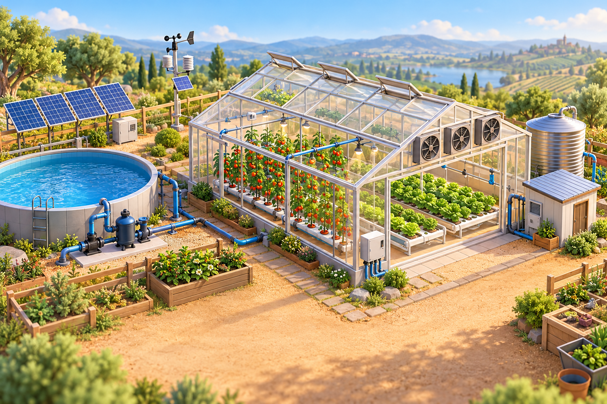

# «Спасение урожая» — интерактивная модель умной фермы



«Спасение урожая» — учебный адаптивный сайт с мини-игрой об управлении
современной умной фермой. Игрок получает сообщения о проблемах на ферме,
выбирает действия и наблюдает, как решения влияют на урожай, состояние растений,
запас воды и энергию.

Проект подготовлен специально для учебной работы **Микаелян Алины
Эдвардовны**, студентки группы **ПОНОИнф-231**.

## Цель проекта

Показать в понятной игровой форме, что умная ферма — это система связанных
датчиков, оборудования и ресурсов. Решение одной проблемы может сохранить
растения, но потребовать дополнительной воды или энергии, поэтому игроку важно
оценивать ситуацию целиком.

## Основные возможности

- интерактивная мини-игра на семь игровых дней;
- набор из 13 различных событий на умной ферме;
- случайный выбор семи событий для каждого нового прохождения;
- перемешивание вариантов ответов A, B и C;
- правильные ответы располагаются в разных позициях;
- немедленное объяснение последствий каждого решения;
- четыре изменяемых показателя фермы;
- журнал пройденных событий;
- пять итоговых званий игрока;
- светлая и тёмная цветовые темы;
- адаптация под компьютер, планшет и телефон;
- отдельная прокомментированная модель игровой логики на C#.

## Игровой процесс

1. Система случайно выбирает 7 событий из общего набора.
2. Игрок читает сообщение и определяет проблемную зону на изображении фермы.
3. Для события предлагаются три действия — A, B и C.
4. После выбора появляется объяснение, а показатели фермы изменяются.
5. Решение записывается в журнал.
6. После седьмого дня рассчитывается итоговый результат и присваивается звание.

Ошибка не завершает игру. Она уменьшает показатели и помогает понять, какое
действие было бы более рациональным.

## События

В общий набор входят следующие ситуации:

1. Аномальная жара.
2. Ошибка датчика влажности.
3. Вредители на листьях.
4. Сильный ливень.
5. Поломка насоса.
6. Холодная ночь.
7. Сухой ветер.
8. Перегрузка электросети.
9. Утечка воды.
10. Предупреждение о граде.
11. Нехватка питательных элементов.
12. Высокая влажность в теплице.
13. Проблема опыления.

Для каждой ситуации предусмотрены собственная зона на схеме фермы, три варианта
действий, изменение ресурсов и пояснение результата.

## Показатели фермы

| Показатель | Назначение |
| --- | --- |
| Урожай | Главный результат прохождения. Снижается из-за серьёзных ошибок. |
| Здоровье | Отражает состояние растений после климатических и биологических угроз. |
| Вода | Показывает оставшийся запас воды для полива. |
| Энергия | Расходуется насосами, вентиляцией, освещением и защитными системами. |

## Итоговые звания

По завершении игры пользователь получает одно из пяти званий:

- **Мастер умной фермы**;
- **Опытный агроном**;
- **Помощник фермера**;
- **Начинающий управляющий**;
- **Нужен новый план**.

Звание зависит от сохранённого урожая и количества рациональных решений.

## Страницы сайта

| Файл | Содержание |
| --- | --- |
| `index.html` | Главная страница, презентация идеи и переход к игре. |
| `project.html` | Проблема, цель, механика, показатели и практическая ценность. |
| `game.html` | Интерактивная игровая панель «Спасение урожая». |
| `author.html` | Информация об авторе учебной работы. |

## Технологии

- HTML5 — семантическая структура страниц;
- CSS3 — дизайн, темы, анимации и адаптивная вёрстка;
- JavaScript — игровые события, случайный порядок ответов и расчёт результата;
- C# — отдельное представление структуры проекта и игровой модели.

Сайт не использует фреймворки и внешние библиотеки, поэтому его можно запустить
без установки зависимостей.

## C#-модель

Файл [`CSharp-модель/CropRescueModel.cs`](CSharp-модель/CropRescueModel.cs)
содержит:

- классы событий, вариантов ответа и последствий;
- состояние игрового прохождения;
- расчёт показателей и итогового звания;
- случайный выбор семи событий;
- распределение правильных ответов между A, B и C;
- описание страниц, дизайна, адаптивности и координат игровых зон;
- поясняющие комментарии к основным классам и функциям.

C#-модель и веб-сайт могут работать независимо. Сайт использует JavaScript, а
C#-файл служит отдельной консольной демонстрацией той же логики.

## Структура проекта

```text
ProjectFerma/
├── assets/
│   ├── favicon.svg
│   └── smart-greenhouse.png
├── CSharp-модель/
│   └── CropRescueModel.cs
├── index.html
├── project.html
├── game.html
├── author.html
├── style.css
├── site.js
├── theme.js
├── rescue-game.js
├── инструкция.txt
└── README.md
```

## Запуск сайта

1. Скачайте репозиторий или клонируйте его:

   ```bash
   git clone https://github.com/tr1zet/ProjectFerma.git
   ```

2. Откройте папку `ProjectFerma`.
3. Запустите файл `index.html` в современном браузере.

Для работы сайта не нужны сервер, база данных или подключение к интернету.

## Запуск C#-модели

Скомпилируйте файл `CSharp-модель/CropRescueModel.cs` любым совместимым
компилятором C#, а затем запустите полученную консольную программу. Модель
случайно выберет семь ситуаций и продемонстрирует рациональное прохождение.

## Дизайн и адаптивность

В оформлении используются кремовый фон, тёмно-синий текст, терракотовый акцент,
голубые и мятные дополнительные цвета. Интерфейс поддерживает светлую и тёмную
темы. На небольших экранах блоки перестраиваются в одну колонку, а навигация
открывается через кнопку меню.

## Учебный характер модели

Все числовые значения, последствия решений и игровые ситуации упрощены для
демонстрации принципов автоматизации сельского хозяйства. Проект не является
практической инструкцией по эксплуатации реального фермерского оборудования.

## Автор работы

**Микаелян Алина Эдвардовна**

Группа: **ПОНОИнф-231**
